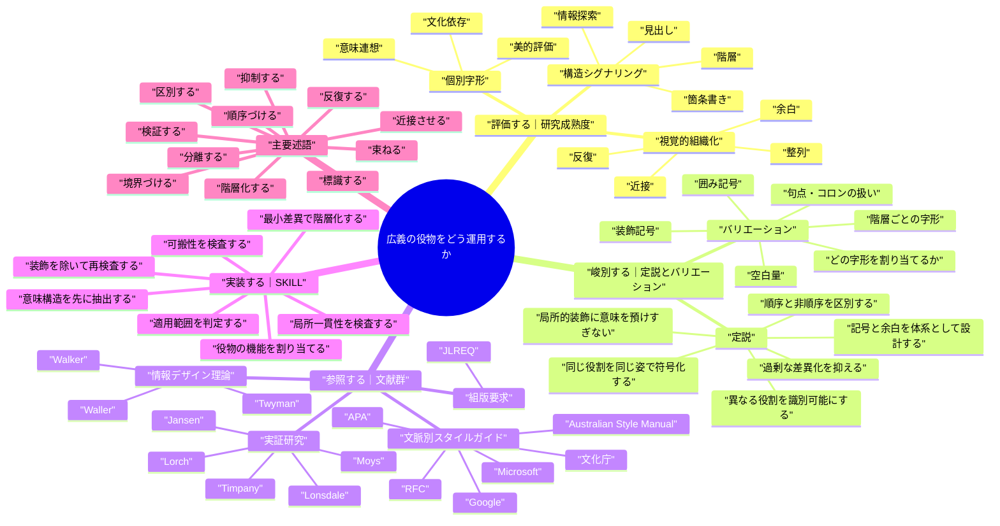

> **資料の位置付け**：本書は `text-structure-visual-signaling` の設計根拠として収録した調査報告です。報告内の長文 `SKILL.md` 案に記載された `visible-punctuation-document-design` は、名称確定前の仮称です。運用上の正本はリポジトリ直下の [SKILL.md](../SKILL.md) です。
>
> **引用に関する注記**：調査時の ChatGPT 固有の引用識別子は GitHub 上で解決できないため、閲覧用の本版では削除しました。末尾の文献情報と各ガイドの URL は残していますが、個別の主張と元の検索結果との完全な対応が復元されたことを意味しません。厳密な典拠確認には原著を参照してください。

---

# 広義の役物による文書設計――定説・バリエーションの峻別とエージェント用 `SKILL.md`



## ◇ 調査範囲と総合判断

今回の対象は、**最終的な読者にそのまま可視化される文字・記号・空白・改行の組合せ**です。したがって、`#` や `*` がパーサーによって見出しやリストへ変換される Markdown 構文は対象外としました。一方、プレーンテキスト中に実際に残る `■`、`◇`、`※`、`【】`、`：`、`—`、番号、箇条書き記号、空行、字下げなどは対象に含めます。これは W3C が plain-text 文書について、可視的な慣習からリストなどの関係を表す方法を独立したアクセシビリティ技法として扱っていることとも整合します。

結論から述べると、この領域では**「どの記号を選ぶべきか」という字形レベルの規範は弱い一方、「記号・空白・配置をどのような関係で運用するか」という構造レベルには、かなり頑健な共通了解があります**。とりわけ、〈同じ役割を同じ見え方で反復する〉、〈異なる階層を知覚可能に区別する〉、〈順序が意味を持つ集合と持たない集合を区別する〉、〈余白と近接によって帰属関係を示す〉、〈記号だけへ意味を預けず語によるラベルを残す〉、〈装飾的差異を増やしすぎない〉という原則は、実験研究、情報デザイン論、タイポグラフィ研究、アクセシビリティ指針、複数の独立したスタイルガイドから収束して導けます。

ただし、この領域を「完成した科学」と呼ぶのは適切ではありません。見出しやリストが探索・記憶・構造理解へ及ぼす効果には実験的な蓄積がありますが、`■` と `◇` のどちらが上位階層に適するか、`【】` と `〈〉` のどちらがラベルとして優れるか、空行を一行にするか二行にするか、といった**個別の実装選択を一般化できる直接比較研究は乏しい**ためです。2025年に公表された見出し差異化の比較研究でさえ、結論は「視覚的重量が大きい見出しほど識別されやすい」という水準であり、特定字形の普遍的優位までは示していません。

添付された `grade-informed-etd-decision-support(2).zip` は実際に展開し、ルートの `SKILL.md`、`decision-structuring`、`evidence-based-writing`、Generic EtD の実行仕様を確認しました。本報告ではその方針に従い、〈一般化可能な原則〉と〈特定の制度・媒体・ジャンルに限られる規範〉を分離し、根拠が限定的な事項はバリエーションとして残しています。

## ◇ 文献レビューと研究成熟度

### 〘 構造を可視化する研究は、比較的成熟している 〙

この領域で最も堅い知見は、**文章の論理構造を視覚的に標識すると、読者が構造を認識し、探索しやすくなる**というものです。Lorch、Lemarié、Grant の4実験では、階層構造を伝える見出しは読者が再構成するアウトラインの完全性・正確性を高め、順序構造を伝える見出しは情報探索を速めました。重要なのは、「見出しがある方がよい」という単純な結果ではなく、**提示した視覚的信号の種類に応じて読者が利用できる組織情報も変わる**ことです。

箇条書きにも一定の実証的裏付けがあります。Jansen の5研究では、同じ内容を段落内列挙として示した場合と比べ、箇条書きが項目内容の想起を改善した研究が複数ありましたが、項目が異質になると効果が弱まり、周辺本文の想起を低下させる場合もありました。したがって、「箇条書きは常に読みやすい」という定説ではなく、**同種の情報をひとまとまりとして際立たせたい場合に有効であり、本文との統合が必要な情報には逆効果もあり得る**、という限定付きの知見です。

Waller の「アクセス構造（access structure）」は、この実証知見を実務へ結び付ける有用な概念です。Waller は、見出し、索引、要約、欄外情報などを、本文そのものとは別に〈読者が必要な情報へ接近するための構造〉として捉えています。この考え方を広義の役物へ適用すると、役物の価値は「美しいか」より先に、**探索・定位・区切り・予告のどれを支援しているか**で評価できます。

### 〘 版面は「個々の記号」ではなく「差異の体系」として研究されている 〙

Twyman の “Typography without Words” は、この問題を扱ううえで特に重要です。Twyman は文字内容を `x`、`o`、`i` などに置き換え、内容から切り離して見出し、本文、空間、配置の関係を検討する記法を提示しました。その目的は特定の見出し字形を推薦することではなく、**タイポグラフィの問題を語彙内容とは独立した関係構造として検討できるようにすること**でした。

Walker の歴史研究も、同じ方向を補強します。タイプライターという限られた「graphic capability」のもとでも、空白、大文字、下線、配置、文字記号の組合せによって複雑な文書階層が形成されてきました。Walker は同時に、タイプライター教本の規則が時代や文書ジャンルに依存していたことも示しており、たとえば中央揃えや全文大文字が権威性を示す慣習として教えられた時期から、効率を理由に左揃えへ移行した歴史を記述しています。つまり、**「構造を差異化する」という原理は持続する一方、具体的な差異化手段は技術と慣習によって変わる**ことが分かります。

Moys の実験研究は、差異の量そのものにも限界があることを示しています。タイポグラフィ上の差異が大きいレイアウトは注意を引き、拾い読みしやすいと評価される一方、よりセンセーショナルとも評価されました。中程度・低程度の差異化は、より深い読みを要求し、権威的・信頼できる印象と関連しました。したがって、視覚的差異を増やせば単調に品質が上昇するわけではなく、**差異化には情報探索上の利益と修辞的副作用の両方がある**と考えるべきです。

Lonsdale の文献レビューも、単一のタイポグラフィ変数だけで最適解を導くことに慎重です。可読性は字体、サイズ、行間、行長、階層その他の要素を相互関係として選ぶ必要があり、研究と実務双方から得られた知見を組み合わせるべきだと整理しています。これは本件にも直接当てはまり、`■` の効果を `■` だけで考えるのではなく、前後の空白、字下げ、見出し語、反復頻度との組合せとして評価すべき理由になります。

### 〘 余白と近接には強い実務合意があるが、絶対値は弱い 〙

余白は「何もない部分」ではなく、まとまりと境界を伝える積極的な変数として扱えます。Walker が調査したタイプライター教本では、見出しと本文、見出しと小見出し、主要部分の間隔を変えることで階層を表しており、この原理自体は古くから繰り返されています。

現在の米国政府デザインシステムも、近い要素には少ない空白、異なる要素には大きい空白を置き、見出しは前節より後続本文へ近接させるという考え方を明示しています。ただし、そこで示される `1.5倍` などの数値は Web デザインシステム固有の実装値であり、プレーンテキスト一般の普遍値として転用すべきではありません。**一般化できるのは「空白量の相対差で帰属を示す」という関係であり、具体的な空白量ではありません。**

### 〘 個別の記号意味については、研究成熟度が低い 〙

一方、`■`、`◇`、`◆`、`○`、`※`、`【】` などの字形ごとに読者がどの意味を安定して読み取るかを、文化横断的・媒体横断的に比較した研究は今回の調査では十分に確認できませんでした。最新の見出し識別研究も「より強い視覚重量」の効果を示すにとどまり、特定の図形記号を一般的階層へ割り当てる根拠にはなりません。

したがって、この領域の成熟度は一枚岩ではありません。**〈構造シグナリング〉は中〜高成熟、〈差異化・近接・一貫性〉は中程度に成熟、〈特定字形の意味割当て〉は低成熟、〈美的優劣〉は低成熟**と評価するのが妥当です。これは、実験が存在するかだけではなく、その実験結果を日常的な日本語プレーンテキストへどの程度直接移せるかという〈直接性〉も加味した判断です。

## ◇ 「定説」と「バリエーション」の峻別

### 〘 定説として採用できる範囲 〙

最も強く採用できる第一原則は、**同じ意味関係には同じ視覚的処理を反復し、異なる意味関係には識別可能な差を与える**ことです。これは、見出し研究における構造シグナリング、スタイルガイドにおけるリストの平行性・一貫性、文化庁が特定の符号について「文書内で用法を統一」と繰り返す姿勢まで、異なる系統の資料に共通します。

第二原則は、**字形ではなく役割を先に決める**ことです。順序が意味を持つ場合は順序を明示し、同列集合では同列性を示し、補足は本文から境界づけ、見出しは後続内容との帰属を示します。APA は番号付き・文字付き・箇条書きを情報関係に応じて区別し、Google、Microsoft、Australian Style Manual も、箇条書きの導入・平行性・句読点をリストの文法的性質から決めています。個別規則は異なりますが、**情報関係を先に定め、記号を後から割り当てる**という設計方向は一致しています。

第三原則は、**空白・改行・記号を別々に扱わず、まとまりを示す一つのシステムとして扱う**ことです。近い要素は同一群として、離れた要素は別群として読まれやすくなるため、見出しと後続本文の間を前節との間より小さくするなど、空白の相対関係が帰属を支えます。具体的な数値は媒体依存ですが、相対的な近接の利用はタイポグラフィ史・実務ガイドの双方に確認できます。

第四原則は、**重要な意味を記号だけへ預けない**ことです。`※`、`▲`、`★` だけで「警告」「例外」「推奨」などを区別すると、字形の意味を知らない読者には関係が復元できません。W3C の認知アクセシビリティ指針は、記号や句読法による曖昧性を減らすことを求め、Google のアクセシビリティ指針も句読記号を取り除いても同じ意味が伝わるようにすることを推奨しています。したがって、重要な状態には `【注意】`、`注意：`、`例外：` のような語彙ラベルを伴わせる方が頑健です。

第五原則は、**必要な差異だけを導入する**ことです。Moys の研究では差異化が強いほど拾い読みしやすくなる一方、文書の印象も変化しました。したがって、「目立たせられるなら目立たせる」のではなく、読者が区別する必要のある関係だけを差異化し、同じ区別を複数の装飾で重複符号化しないことが合理的です。

第六原則は、**文書内で使う視覚語彙を小さく保つ**ことです。この原則は直接的な「記号数の最適値」を示した実験からではなく、構造を少数の視覚変数で表す Twyman の方法、限られた手段による階層形成を分析した Walker、属性の組合せによる効果を示した Moys から導く実務的統合です。したがって、「三種類以内」のような固定値ではなく、〈新しい字形を加えるたびに新しい意味上の区別があるか〉を問う形で採用するのが適切です。

### 〘 バリエーションとして残すべき範囲 〙

これに対し、**`■` を大見出し、`◇` を小見出し、`※` を注記に固定するような字形対応は、一般原則ではありません**。文化庁『公用文作成の考え方』は、矢印や箇条書き冒頭の `・、○、●、◎、◇、◆、□、■` などについて特定の普遍的な割当てを示さず、文書内で用法を統一することを求めています。同文書自身も国の府省庁における公用文という特定用途の手引であり、その個別規則を日本語一般へ昇格させる根拠はありません。

箇条書き末尾の句読点も代表的なバリエーションです。Australian Government Style Manual は一般コンテンツで最小限の句読点を推奨し、Microsoft は完全な文なら句点、短い句なら無句点という区分を採用し、Google も項目の文法形態に応じた規則を持ちます。ここから得られる共通原則は「句点を付ける／付けない」ではなく、**同じリストの項目を文法的に平行化し、その性質に応じて終止法を一貫させる**ことです。

見出し末尾の句点、コロンの使用、囲み括弧の種類、段落字下げ、中央揃え、空行数も同様です。これらは文書文化、媒体、技術、ジャンルによって規範が変わってきたことが Walker の歴史研究から明確であり、現行スタイルガイド間にも差があります。したがって、SKILL に固定値として埋め込むより、**文脈別プロファイルとして選択可能にする**方が頑健です。

JLREQ はさらに異なる種類の資料です。これは日本語組版における禁則、括弧、句読点、字間調整などを詳細に記述した技術的要件であり、日本語文字列を適切に組版するうえで重要な基盤です。しかし、`■` をどの意味役割へ割り当てるかという情報デザイン上の規範を定める資料ではありません。したがって、**日本語として破綻しない組版の制約条件には使えるが、文書の視覚語彙を決める普遍スタイルガイドとしては使わない**、という位置付けが適切です。

## ◇ `SKILL.md` の設計論

エージェント用ハンドブックでは、**「正解となる字形の表」を中心に置かず、「意味関係→視覚機能→具体字形」という三段階の判断を強制する**設計が最も安定します。この順序なら、`■`、`◆`、`◇` の文化的ニュアンスや媒体制約が変わっても、〈階層を表す〉、〈同列性を表す〉、〈補足を境界づける〉という上位判断は保持できます。これは、Twyman の内容から切り離した構造思考、Waller のアクセス構造、Lorch らの構造シグナリング研究を実務化したものです。

また、SKILL は〈定説〉と〈スタイルプロファイル〉を明示的に分離する必要があります。文化庁、APA、Google、Microsoft、Australian Government などの具体規則を同列に混ぜると、「政府文書ではこうだから一般文書でもこうすべき」という誤った一般化が起こります。むしろ、各資料は**ある文脈で、共通原則をどのように具体化したかを見る比較事例**として格納するのが適切です。

品質検証には、通常の校正とは別に〈構造だけを見る検査〉を入れるべきです。Twyman の方法にならい本文内容を捨象して、見出し・ラベル・空白・記号だけを見たときに階層を推定できるかを確認し、その逆に記号を除去しても重要な意味関係を語彙から回復できるかを確認します。前者は視覚構造の不足を、後者は記号への過度な意味依存を発見します。

以下の `SKILL.md` は、この設計論をそのままエージェントへ移植できる形へまとめています。特定字形を規範化せず、日常的なメモ、研究ノート、報告書、メール本文、プレーンテキスト仕様書、簡易マニュアルなどへ横断的に適用できることを優先しています。

## ◇ 完全版 `SKILL.md` スニペット

```markdown
---
name: visible-punctuation-document-design
description: >
  プレーンテキストおよび日常文書に実際に表示される広義の役物
  （括弧、見出し記号、区切り、ラベル、箇条書き記号、番号、
  空白、改行、字下げ等）を用いて、文書の階層、まとまり、
  順序、注記、境界、探索性を明確にする。
  特定の記号を普遍的に推奨せず、意味構造を先に確定し、
  記号・余白・配置を一貫した視覚語彙として割り当てる。
metadata:
  version: "1.0"
  language: "ja"
---

# 広義の役物による文書設計

## 目的

読者が本文を精読する前でも、文書の〈まとまり〉〈階層〉
〈順序〉〈補足〉〈注意〉〈境界〉を推定できるようにする。

役物を装飾として追加することではなく、
文章がもともと持つ意味関係を視覚的に標識することを目的とする。

特定の字形を普遍的な正解として扱わない。
先に意味上の役割を確定し、その後で媒体・言語・ジャンル・既存慣行に
適した字形、空白、改行、字下げを割り当てる。

## 適用範囲

対象に含めるもの：

- 読者にそのまま見える括弧・囲み記号
- 見出しの冒頭または周囲に置く記号
- 箇条書き項目の可視マーカー
- 順序・階層・参照のための番号
- 注記・補足・注意を標識する記号または語彙ラベル
- セクション間の区切り記号
- 空行、改行、字下げ、位置揃え
- 上記の組合せによる視覚的階層

対象から除外するもの：

- レンダリング時に消える、または別の構造へ変換される
  Markdown 等のパーサー構文そのもの
- HTML、XML 等のマークアップ構文そのもの
- CSS 等の実装コードだけを対象とするスタイル指定
- 特定フォント内部の字形設計そのもの
- 数式記号、プログラミング演算子等について、
  専門分野固有の意味規約だけを論じる場合

Markdown 等で作成された文書でも、
最終表示に残る「■」「※」「【注】」等は対象に含める。
構文として解釈され消える記号は対象に含めない。

## 中心原則

### 意味関係を先に確定する

記号を選ぶ前に、その箇所が何を伝える必要があるかを分類する。

主要な機能は次のとおりとする。

- 束ねる：複数の要素を同じ集合として示す
- 階層化する：上位・下位の包含関係を示す
- 順序づける：時間、手順、順位、参照順を示す
- 境界づける：本文と補足、節と節、項目と説明を分ける
- 標識する：注意、例外、定義、条件等の役割を示す
- 対応づける：ラベルと値、項目名と説明を結び付ける
- 分離する：異なるまとまりを視覚的に離す
- 近接させる：同じまとまりに属するものを視覚的に寄せる

「見栄えを良くする」だけを役割として新しい記号を追加しない。
装飾が必要な場合も、既存の意味構造を妨げない範囲へ限定する。

### 同じ役割を同じ姿で反復する

同じ階層、同じ種類の注記、同じ種類のリストには、
原則として同じ視覚的処理を反復する。

同じ記号を複数の異なる意味へ安易に兼用しない。

例：

良い：
■ 大節
■ 大節

◇ 小節
◇ 小節

注意：
注意：

避ける：
■ がある箇所では大節、
別の箇所では警告、
さらに別の箇所では単なる装飾を意味する。

文書途中で割当てを変更する必要が生じた場合は、
既存箇所も含めて体系全体を再調整する。

### 異なる役割には識別可能な差を与える

読者が区別する必要のある二つの役割を、
まったく同じ視覚形式へ割り当てない。

ただし、差を増やしすぎない。
必要な意味上の区別一つにつき、
識別に必要な最小限の視覚差を設ける。

差異化には次の変数を利用できる。

- 記号の種類
- 記号の有無
- 番号の有無
- 空行の量
- 字下げ
- 前後位置
- 囲みの有無
- ラベル語
- 大文字・小文字等、媒体で安定して表示される差

複数の変数を同時に変える場合は、
その重複が本当に必要かを確認する。

### 記号より関係を優先する

「■は上位」「◇は下位」のような対応を
普遍的規則として仮定しない。

まず、

上位見出し
  └ 下位見出し
      └ 本文

という意味構造を確定し、
その後で候補となる視覚表現を選ぶ。

例：

案A
■ 上位
◇ 下位

案B
【上位】
  ・下位

案C
上位
  ─ 下位

いずれも、それ自体では普遍的な正解ではない。
既存文書との整合、読者の慣れ、文字環境、視認性、
他の用途との衝突を見て選択する。

### 空白を構造として扱う

空白は「何もない部分」ではなく、
まとまりと境界を示す視覚変数として扱う。

基本関係は次のとおりとする。

- 同じまとまり → 相対的に近接させる
- 異なるまとまり → 相対的に離す
- 見出し → 前節より、後続本文との結び付きを強く見せる
- 同一リストの項目 → 節間より狭い間隔に保つ
- 大きな区切り → 小さな区切りより強い空白差を与える

固定した空行数を普遍規則にしない。
媒体上、一行しか空けられない場合もあれば、
印刷物では別の間隔が適切な場合もある。

重要なのは絶対値ではなく相対関係である。

### 順序と同列を混同しない

項目の順序が意味を持つ場合は、
順序を認識できる形式を選ぶ。

対象例：

- 手順
- 時系列
- 優先順位
- 後から参照する項目
- 一定の並び順そのものが意味を持つ説明

順序が意味を持たない場合は、
番号を付けることで不要な順位関係を暗示しない。

番号を単なる装飾として使わない。

### ラベルは意味を言語化する

注意、警告、例外、条件、定義、補足など、
誤認による影響が大きい役割は、
記号だけでなく語彙ラベルでも示すことを優先する。

推奨：

【注意】……
注意：……
［例外］……
条件：……

慎重に扱う：

※ ……
▲ ……
★ ……

後者を用いる場合も、
記号の意味を初見で推測できるとは仮定しない。

重要度・危険度・推奨度等を
記号の形だけで符号化しない。

### 箇条書き内部を平行化する

同じリスト内の項目は、
意味上および文法上、可能な範囲で平行にする。

例：

良い：
・目的を確認する
・条件を整理する
・候補を比較する

避ける：
・目的
・条件を整理する
・候補について比較した結果

項目の長さを完全に同じにする必要はない。
読者が「同じ種類のものが並んでいる」と理解できる構造を優先する。

項目末尾の句読点は、
採用するスタイルに合わせて統一する。
「常に付ける」「常に付けない」を普遍規則としない。

### 視覚語彙を小さく保つ

新しい記号を導入するたびに、
既存の視覚語彙で表せない新しい意味上の区別があるか確認する。

例：

すでに
■ 大節
◇ 小節
※ 注記

がある場合に、

◆ 重要節
□ 中間節
◎ 特別節
★ とても重要
▶ 参考

を無条件に追加しない。

必要な区別が増えた場合は、
字形追加だけで解決せず、
見出し語、番号、空白、文章構造の再編も候補に含める。

### 装飾へ意味を預けすぎない

記号を除去したとき、
重要な内容関係が完全に失われる文書を避ける。

特に次の情報は文章でも回復可能にする。

- 注意か例外か
- 必須か任意か
- 順序があるか
- 誰に適用する条件か
- 何の補足か
- どの見出しの下位か

装飾記号は意味を補強できるが、
重要な意味の唯一の担い手にはしない。

## 判断手順

### 文書目的を確定する

最初に次を確認する。

- 読者は精読するか、拾い読みするか
- 文書は一度読むものか、後から参照するものか
- 読者は専門家か一般読者か
- 文書は短いか長いか
- 既存のスタイルやテンプレートがあるか
- テキストが別環境へコピーされる可能性があるか
- 等幅／可変幅、全角／半角、縦書き／横書き等の制約があるか

既存の組織スタイルがある場合は、
合理的な理由がない限りその一貫性を優先する。

### 意味構造を抽出する

役物を除いた状態で文書を読み、
最低限次を特定する。

- 最上位のまとまり
- 下位のまとまり
- 同列項目
- 順序付き項目
- 注記
- 例外
- 条件
- ラベルと内容の対応
- 主要な節境界

意味構造が曖昧なら、
記号追加より先に文章構造を修正する。

### 必要な視覚差を決める

各構造について、
読者が見分ける必要がある差だけを選ぶ。

優先順位：

1. 空白・位置
2. 言語ラベル
3. 番号
4. 記号
5. 装飾的な追加差異

この順位は絶対規則ではない。
ただし、新しい記号を増やす前に、
空白や語彙だけで十分かを検討する。

### 字形を割り当てる

候補字形は以下から選べるが、
用途は固定しない。

・ ○ ● ◎
◇ ◆
□ ■
△ ▲
※
→ ⇒
｜ ─ —
（）［］【】〈〉《》
：／・
数字、ローマ字、かな等

選択時には次を確認する。

- 既存用途と衝突しない
- 小さい画面でも区別できる
- コピー＆ペーストで保持される
- 使用環境の文字コードで安定する
- 別の一般的意味を強く想起させない
- 見出し語そのものより目立ちすぎない

特殊なUnicode記号を装飾目的だけで大量投入しない。

### 反復規則を確定する

割当てを決めたら、
文書内で再利用できる簡単な規則へ落とす。

例：

大節：
■ 見出し

小節：
◇ 見出し

注記：
【注】本文

同列列挙：
・項目

手順：
1. 項目
2. 項目

区切り：
空行二つではなく「大節前の空白」として相対的に管理

必要なら文書冒頭に凡例を置く。
ただし、短い日常文書で凡例が本文より重くなる場合は置かない。

## 文脈別の選択

### 短いメモ・チャット・メール

目的：
迅速な走査と誤読防止。

推奨：
- 階層を浅く保つ
- 見出し記号を少数に限定する
- 重要な状態は語彙ラベルで示す
- 空行を積極的に使う
- 複雑な入れ子を避ける

例：

■ 今日決めること

・会場
・開始時刻
・担当者
【未確定】終了時刻

### 研究ノート・調査記録

目的：
後から参照し、出所・判断・未確定事項を識別する。

推奨：
- 内容階層と状態ラベルを分ける
- 「事実」「解釈」「仮説」「TODO」等を語で示す
- 同じ記号に階層と状態の二役を与えない
- 参照が必要なら番号を利用する

例：

■ 観察結果

◇ 対象A

【観察】……
【解釈】……
【未確認】……

### 手順書

目的：
順序の保持と作業漏れ防止。

推奨：
- 手順には明示的な順序を付ける
- 補足を手順番号と混同しない
- 分岐条件をラベルで明示する
- 注意事項を装飾記号だけで示さない

例：

1. 電源を切る。
2. ケーブルを外す。

【注意】手順2より先にケースを開けない。

3. ケースを開ける。

### 比較・評価文書

目的：
同じ観点で複数候補を比較する。

推奨：
- 候補ごとの視覚処理を対称にする
- 一方だけ過度に強調しない
- 評価軸のラベルを反復する
- 推奨記号を使う場合も理由を文章化する

### 公的・制度的文書

既存の法令、官公庁、組織、出版者のスタイルガイドがある場合は、
その文脈固有の規則を優先する。

ただし、その規則を別文脈へ自動的に一般化しない。

## 参照事例としてのスタイルガイド

以下は普遍規則ではなく、
共通原則が特定文脈でどう具体化されているかを見るための事例とする。

### 文化審議会『公用文作成の考え方』

対象：
日本の国の府省庁等が作成する公用文。

参考になる点：
- 文書内で符号の用法を統一する
- 濫用を避ける
- 箇条書き冒頭の符号を一貫して使う
- 項目階層の例を示す
- 【】を項目表示・強調に利用する事例を示す

普遍化しない点：
- 個々の符号の割当て
- 公用文固有の階層番号体系
- 公用文固有の句読法

参照：
https://www.bunka.go.jp/seisaku/bunkashingikai/kokugo/hokoku/93657201.html

### W3C 日本語組版処理の要件（JLREQ）

対象：
日本語文字列の組版要件。

参考になる点：
- 括弧・句読点の配置
- 禁則
- 行分割
- 字間調整
- 日本語組版特有の文字クラス

普遍化しない点：
- 情報デザイン上の役割と個別記号の対応
- 日常メモにおける見出し記号の選択

参照：
https://www.w3.org/TR/jlreq/

### APA Style

対象：
主として学術文書。

参考になる点：
- リスト項目の概念的・統語的平行性
- 順序付きリストと箇条書きの区別
- 見出し階層の一貫性

参照：
https://apastyle.apa.org/style-grammar-guidelines/lists
https://apastyle.apa.org/style-grammar-guidelines/paper-format/headings

### Microsoft Writing Style Guide

対象：
技術・製品ドキュメント。

参考になる点：
- リスト導入部と項目の関係
- 項目末尾句読点の一貫性
- 短い項目と完全な文の区別
- スキャンしやすい構造

参照：
https://learn.microsoft.com/en-us/style-guide/scannable-content/lists

### Google Developer Documentation Style Guide

対象：
技術ドキュメント。

参考になる点：
- リストの型を意味関係に合わせる
- 項目の平行性
- ラベル付きリスト
- アクセシビリティ上、句読記号だけへ意味を預けない

参照：
https://developers.google.com/style/lists
https://developers.google.com/style/accessibility

### Australian Government Style Manual

対象：
豪州政府コンテンツ。

参考になる点：
- 最小限の句読法
- リスト導入部と項目の統一
- 見出し・リストによる走査性

参照：
https://www.stylemanual.gov.au/structuring-content/lists
https://www.stylemanual.gov.au/structuring-content/headings

### RFC Editor

対象：
技術標準文書およびそのplain-text表現。

参考になる点：
- plain textにおける可搬性
- セクション番号・見出しの一貫性
- 複数出力形式を想定した構造管理

参照：
https://www.rfc-editor.org/authors/rfc-style-guide/
https://www.rfc-editor.org/info/rfc7994/

## 禁止・注意

### 特定字形を普遍的意味へ固定しない

次のように断定しない。

「■は必ず大見出し」
「◇は必ず小見出し」
「※は必ず補足」
「【】は必ず重要事項」

特定組織・媒体のスタイルとして指定されている場合のみ従う。

### 記号の種類だけで階層を深くしない

■
◆
◇
○
・
-
→

のように字形だけを増やして
深い階層を表現し続けない。

深い階層が必要なら、
文書構造そのものの分割を検討する。

### 階層と重要度を混同しない

上位見出しは必ずしも
「より重要な内容」を意味しない。

階層は包含関係、
重要度は価値判断である。

別の概念として扱う。

### 順序番号を装飾に使わない

01、02、03 等を使うと、
読者は順序・識別子・参照可能性のいずれかを推測する。

その意味が不要なら、
番号を単なる飾りとして追加しない。

ただし、雑誌的・表現的なデザインを意図する文書では、
装飾番号として使う余地がある。
その場合は実用文書の原則からの意図的逸脱として扱う。

### 同じ情報を過剰に重複符号化しない

例：

■■■【!!!重要!!!】★★★

のように、
同じ重要性を多数の記号で重ねない。

強調が必要なら、
一つまたは少数の安定した方法へ集約する。

### 可搬性を損なう記号を無条件に使わない

環境によって表示されない可能性がある
特殊記号、絵文字、結合文字等は、
可搬性が必要な文書で慎重に扱う。

別環境へ転送・コピーされる文書では、
一般的なUnicode文字と語彙ラベルを優先する。

### 罫線文字へ依存しすぎない

┌────┐
│    │
└────┘

のような文字罫は、
等幅環境では有効でも、
可変幅フォント、折り返し、狭い画面で崩れる場合がある。

必要な場合は、
崩れても意味が失われない本文構造を残す。

## 例外

### 既存スタイルとの一貫性が優先される場合

組織、雑誌、学会、法令、技術仕様等に
明示的なスタイルが存在する場合、
一般原則より既存スタイルとの整合を優先できる。

ただし、アクセシビリティ上重大な問題、
文字化け、意味の誤認等が予想される場合は、
例外として改善案を示す。

### 表現性そのものが目的の場合

詩、広告、ポスター、ファンジン、
実験的タイポグラフィ等では、
通常の探索性・一貫性より表現性を優先できる。

このSKILLの原則を
「禁止事項」ではなく比較対象として扱う。

### 極端に短い文書

数行のメモでは、
完全な階層体系を導入すると過剰設計になる。

必要最小限の区切りとラベルだけを採用する。

## 品質検証

完成後、以下を順番に確認する。

### 構造検査

- 本文を読まずに、節の境界を推定できるか
- 同じ階層が同じ姿に見えるか
- 上位と下位を区別できるか
- 同列項目と順序付き項目を区別できるか
- 見出しがどの本文へ属するか分かるか
- 注記が何を注記しているか分かるか

### 一貫性検査

- 同じ記号が複数の意味に使われていないか
- 同じ意味に複数の記号が無理由に使われていないか
- リスト項目の文法形式がそろっているか
- 項目末尾の句読法がそろっているか
- 空白量の相対関係が一貫しているか

### 除去検査

記号・装飾だけを仮に除去する。

確認事項：

- 注意と補足を文章から区別できるか
- 手順の順序を回復できるか
- 必須条件を回復できるか
- 重要な意味が完全に消えないか

重要な意味が失われる場合は、
語彙ラベルまたは本文説明を補う。

### 抽象化検査

本文の語句を
「見出し」「本文」「項目」等のダミー語へ置き換えて想像する。

確認事項：

- 階層が視覚的に追えるか
- 見出し間の差が十分か
- 差異が多すぎないか
- 大きな境界と小さな境界を区別できるか

### 過剰設計検査

各記号について問う。

「この記号を削除すると、
どの意味上の区別が失われるか。」

答えられない記号は削除候補とする。

### 可搬性検査

可能なら次の環境を想定する。

- スマートフォン
- PC
- 等幅フォント
- 可変幅フォント
- コピー＆ペースト後
- メール転送後
- プレーンテキスト化後

崩れたときに意味まで失われる構造は修正する。

### 読み上げ・認知負荷検査

記号を読み飛ばす、
または名称として読み上げる環境を想定する。

記号がなくても重要な意味が理解できるか確認する。

同時に、
記号の種類を覚えなければ読めない文書になっていないか確認する。

## 出力時の判断規則

ユーザーが文書作成を依頼した場合：

1. 内容構造を先に整理する。
2. 必要な階層数を確定する。
3. 文脈に既存スタイルがあるか確認する。
4. 役物の役割を割り当てる。
5. 最小限の視覚語彙を選ぶ。
6. 同じ役割へ同じ処理を反復する。
7. 空白でまとまりを補強する。
8. 重要な意味には語彙ラベルを残す。
9. 構造検査・除去検査・過剰設計検査を実施する。
10. 特定のスタイルガイドへ従った場合は、
    それが文脈固有の選択であることを必要に応じて示す。

ユーザーが既存文書の推敲を依頼した場合：

1. 現行の視覚語彙を一覧化する。
2. 各記号の実際の役割を分類する。
3. 一対多・多対一の不整合を探す。
4. 意味構造を変えずに視覚語彙を整理する。
5. 既存の個性は、理解を妨げない限り保持する。
6. 「好み」だけを理由に全面的な字形置換を行わない。

## 根拠の強度

### 強度A：比較的強い

対象：
- 見出し等の構造シグナルが
  階層理解・探索を支援する
- 同列情報のリスト化が
  特定条件で項目想起を支援する
- 明確な視覚的差異が
  見出し識別を支援する

主な根拠：
Lorch, Lemarié & Grant (2011)
Jansen (2014/2015)
Timpany (2025/2026)

### 強度B：複数資料が収束する実務原則

対象：
- 同じ役割の一貫した表示
- 視覚語彙の体系化
- 空白と近接によるまとまり
- 属性を単独でなく組合せとして考える
- リスト項目の平行性
- 重要な意味を記号だけに依存させない

主な根拠：
Twyman (1981)
Walker (2018)
Moys (2013, 2014)
Lonsdale (2014)
W3C accessibility guidance
複数の独立したスタイルガイド

### 強度C：文脈依存の慣習

対象：
- 特定の字形を特定階層へ割り当てる
- 箇条書き末尾の句読点
- 見出し末尾の句読点
- 囲み括弧の種類
- 空行の具体的な数
- 字下げ量
- 特定の番号体系

扱い：
普遍規則として断定しない。
既存スタイル、媒体、文化、ジャンルに応じて選択する。

### 強度D：根拠が乏しいため慎重に扱う

対象：
- 「■の方が◇より上位に見える」等の普遍的主張
- 特定記号の美的優位
- 特定の装飾記号が読者一般に同じ感情を喚起するという主張
- 記号の最適個数を固定値で示すこと

扱い：
必要なら候補として提示するが、
研究上の定説とは表現しない。

## 主要文献

Michael Twyman. "Typography without Words."
Visible Language 15(1), 1981, pp. 5–12.
https://journals.uc.edu/index.php/vl/article/view/5310

Robert Waller. "Typographic Access Structures for Instructional Text."
In Processing of Visible Language, 1979.
概念解説：
https://designthings.org/things/access

Sue Walker. "Modernity, Method and Minimal Means:
Typewriters, Typing Manuals and Document Design."
Journal of Design History 31(2), 2018, pp. 138–153.
DOI: 10.1093/jdh/epx018

Robert F. Lorch Jr., Julie Lemarié, Russell Grant.
"Signaling Hierarchical and Sequential Organization in Expository Text."
Scientific Studies of Reading 15(3), 2011, pp. 267–284.
DOI: 10.1080/10888431003747535

Frank Jansen.
"How Bulleted Lists and Enumerations in Formatted Paragraphs
Affect Recall and Evaluation of Functional Text."
Information Design Journal 21(2), 2014/2015, pp. 146–162.
DOI: 10.1075/idj.21.2.06jan

Jeanne-Louise Moys.
"Investigating Readers' Impressions of Typographic Differentiation
Using Repertory Grids."
Visible Language, 2013.

Jeanne-Louise Moys.
"Typographic Layout and First Impressions:
Testing How Changes in Text Layout Influence Readers' Judgments of Documents."
Visible Language, 2014.
https://journals.uc.edu/index.php/vl/article/view/5879

Maria dos Santos Lonsdale.
"Typographic Features of Text:
Outcomes from Research and Practice."
Visible Language 48(3), 2014, pp. 29–67.
https://journals.uc.edu/index.php/vl/article/view/5887

Claire Timpany.
"Identification of Headings in Print and Screen
Using Typographic Differentiation."
Information Design Journal 30(2), 2025/2026, pp. 97–116.
DOI: 10.1075/idj.25001.tim

W3C.
Requirements for Japanese Text Layout.
https://www.w3.org/TR/jlreq/

W3C WAI.
"Using Standard Text Formatting Conventions for Lists."
https://www.w3.org/WAI/WCAG21/Techniques/text/T2

W3C WAI.
"Use Clear, Unambiguous Formatting and Punctuation."
https://www.w3.org/WAI/WCAG2/supplemental/patterns/o3p06-format-punctuation/

文化審議会.
『公用文作成の考え方』2022年.
https://www.bunka.go.jp/seisaku/bunkashingikai/kokugo/hokoku/93657201.html

## 最終原則

役物の良い運用とは、
「正しい記号を知っていること」ではない。

文章に存在する関係を、
少数の視覚的手段によって、
一貫して、識別可能に、過不足なく表すことである。

したがって最終判断は、

意味構造
→ 読者が見分ける必要のある関係
→ 必要最小限の視覚差
→ 文脈に適した字形
→ 一貫性と可搬性の検証

の順序で下す。
```

## ◇ 根拠体系としての位置付け

この `SKILL.md` で最も重要な設計上の区別は、**原則と実装例を分離したこと**です。文化庁の `【】`、Australian Style Manual の「最小限の句読法」、Microsoft のリスト終止法、APA のリスト型などは、それぞれ有用な実例ですが、その有用性は〈ある共同体が視覚語彙を一貫して運用している〉点にあります。そこから個別の字形や句読法だけを切り出して一般化するのは、根拠の射程を越えます。文化庁自身も、矢印や箇条書き冒頭の多様な符号について「特に定めはない」ことを前提に、文書内の統一と濫用回避へ重点を置いています。

研究成熟度を Evidence-to-Decision 的に捉えるなら、**日常文書へそのまま推奨できる確度が最も高いのは「構造を可視化する」「同じ意味を同じ処理で反復する」「順序・階層・集合を区別する」「重要な意味を記号だけに預けない」という関係レベルの原則**です。見出しによる階層・順序シグナリング、リスト化の効果、見出しの視覚的識別については直接的な実験が存在し、複数の実務指針も同じ方向を支持します。

その次に確度が高いのは、**空白、近接、反復、差異化を複合的に扱う設計原則**です。ここには研究・歴史・専門実務が収束していますが、媒体を越えて使える固定数値までは導けません。したがって `SKILL.md` では、「空行を一つ入れる」ではなく「同じまとまりは相対的に近く、異なるまとまりは相対的に遠く」と記述しました。

確度が最も低いのは、**個別字形の序列、美的優位、文化を越えた意味連想**です。ここを規範化しないことが、このハンドブックの頑健性を支えます。`■`、`◇`、`【】`、`※` は便利な視覚資源ですが、その価値は形そのものより〈文書内で何を意味するよう割り当てられ、どれだけ安定して反復されるか〉によって決まる、と扱うのが現在の研究状況に最も整合的です。